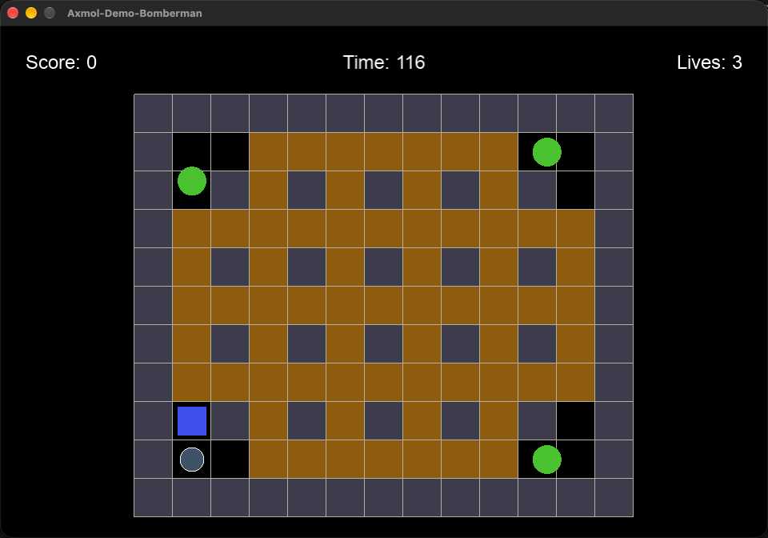

# Axmol Demo: Bomberman

[](LICENSE)

A small Bomberman built with [Axmol Engine](https://axmol.dev/) and C++, written as a learning resource. It covers basic grid-based bomb gameplay, and the code is split into small parts that are easy to read one at a time.



## Gameplay

- Move with the **arrow keys**, drop a bomb with **Space**, restart with **R**.
- You have **3 lives** and **120 seconds**.
- A bomb explodes after 2 seconds. The blast reaches 2 tiles in each direction, destroys walls, stops at steel, and sets off other bombs it touches.
- You can have one bomb on the grid at a time.
- Touching an enemy or standing in fire costs a life. You are briefly invincible after respawning.
- Each enemy killed by a blast gives 100 points. Kill all three to win.
- The game ends when you win, lose all lives, or the timer reaches 0.

There are no image assets: everything is drawn with `DrawNode`.

## Requirements

* A C++ development environment
* [CMake](https://cmake.org/) 3.22 or later
* [Axmol Engine](https://github.com/axmolengine/axmol) 2.x and the platform tools it requires

Refer to the [Axmol documentation](https://axmol.dev/manual/latest/) for installation and platform setup.

## Build and run

Clone the repository, then use the Axmol command-line tools:

```bash
git clone https://github.com/theSlyest/Axmol-Demo-Bomberman.git
cd Axmol-Demo-Bomberman
axmol run -p osx -a arm64    # build and launch on Apple Silicon macOS
```

Change `-p` (and `-a`) for your platform, for example `-p win32` or `-p linux`. To build without launching, use `axmol build` with the same options. The platform project folders (`proj.android`, `proj.ios_mac`, `proj.linux`, `proj.wasm`, `proj.win32`, `proj.winrt`) come from the Axmol project template.

## How the code is organized

The scene only builds nodes and connects them. Input, rules and presentation do not know about each other.

```
BombermanScene          creates the nodes, wires everything, forwards update(dt)
 ├─ BomberControls      keyboard -> held direction + onDirectionPressed / onBomb / onRestart
 ├─ BomberGame          rules and state; calls onScoreChanged / onLivesChanged /
 │   │                  onTimeChanged / onGameOver
 │   └─ EnemyBrain      decides where an enemy goes next
 ├─ BomberHud           score, time and lives labels
 ├─ BomberGameOverLayer overlay shown when the game ends
 └─ BomberGrid          tiles, bombs and explosions (with the player and enemies as children)
```

Each frame the scene passes the held direction from `BomberControls` to `BomberGame::update`. The game updates the world and notifies the scene, which updates the HUD or shows the overlay. The commit history follows the refactor step by step, so it also works as a walkthrough.

### The grid owns the geometry

`BomberGrid` is the only place that knows the tile size. Game code and enemy brains ask it questions instead of doing the math:

```cpp
BomberGrid::neighborPosition(pos, direction);  // position of the next tile
grid.isSafe(pos);                              // can something walk here?
grid.getTileAtCenter(actor->getPosition());    // tile under an actor
```

Changing `GridTile::SIZE` or `BomberGrid::BLAST_RANGE` changes the game without touching the rules.

### Try it: change how enemies behave

Enemies pick their next direction through `EnemyBrain`. To change their behavior, implement it:

```cpp
class ChaseBrain : public EnemyBrain
{
public:
    explicit ChaseBrain(const BomberPlayer* target) : _target(target) {}

    ax::Vec2 chooseDirection(const BomberGrid& grid, const ax::Vec2& pos) override
    {
        // Pick the free direction that gets closest to _target->getPosition().
    }

private:
    const BomberPlayer* _target;
};
```

Then pass it to `BomberGame` in `BombermanScene::initGame`:

```cpp
_game = std::make_unique<BomberGame>(_grid, _player, _enemies, std::make_unique<ChaseBrain>(_player));
```

## What this example shows

| Concept | Where |
| --- | --- |
| Scene setup and wiring the parts together | `BombermanScene` |
| Frame loop with `update(dt)` | `BombermanScene::update`, `BomberGame::update` |
| Keyboard input (`EventListenerKeyboard`) | `BomberControls` |
| Game rules kept separate from the scene, reporting changes through callbacks | `BomberGame` |
| HUD labels and a game-over overlay as their own nodes | `BomberHud`, `BomberGameOverLayer` |
| Grid-locked movement (move tile to tile, turn only at tile centres) | `BomberGame::updatePlayer`, `BomberGame::updateEnemy` |
| Swappable enemy AI (strategy pattern) | `EnemyBrain`, `RandomWalkBrain` |
| Inheritance for shared behavior (`BomberActor` → `BomberPlayer`, `BomberEnemy`) | `BomberActor` |
| Procedural drawing with `DrawNode`, no image assets | `GridTile`, `BomberPlayer`, `BomberEnemy`, `BomberBomb` |
| Tile state machine (`SAFE`, `WALL`, `STEEL`, `BOMB`) and timers | `GridTile`, `BomberGrid::update` |
| Chain-reaction explosions, with the blast range as a constant | `BomberGrid::detonate`, `BomberGrid::BLAST_RANGE` |
| Grid coordinates vs. pixel positions kept inside the grid | `BomberGrid::coordsToPosition`, `positionToCoords`, `neighborPosition`, `getTileAtCenter` |
| Reference counting (`retain`/`release`) for objects shared between nodes | `GridTile::setBomb`, `BomberBomb` |

## Source layout

- `Source/BombermanScene.*`: creates the nodes and connects them.
- `Source/BomberControls.*`: keyboard handling. `Directions.h` holds the four grid directions.
- `Source/BomberGame.*`: score, lives, time, movement, bombs, fire, win and lose.
- `Source/EnemyBrain.h`, `Source/RandomWalkBrain.*`: the enemy decision interface and its default.
- `Source/BomberHud.*`, `Source/BomberGameOverLayer.*`: the on-screen labels and the end overlay.
- `Source/BomberGrid.*`: builds the 13x11 map, runs bombs and explosions, and converts between tile coordinates and positions so other code never does tile-size arithmetic.
- `Source/GridTile.*`: one cell of the map with its state, fire overlay and timers.
- `Source/BomberActor.*`: shared walking behavior (direction, destination, speed, spawn invincibility).
- `Source/BomberPlayer.*`, `Source/BomberEnemy.*`: the blue player (can drop a bomb) and the green enemies.
- `Source/BomberBomb.*`: the bomb sprite, linked back to the player who dropped it.
## Disclaimer

This project is intended for experimentation and education. It simplifies architecture, error handling and content in order to keep the concepts easy to follow.

## License

This repository is licensed under the MIT License. See the [LICENSE](LICENSE) file for details.

Third-party assets and dependencies may be subject to their own licenses.
